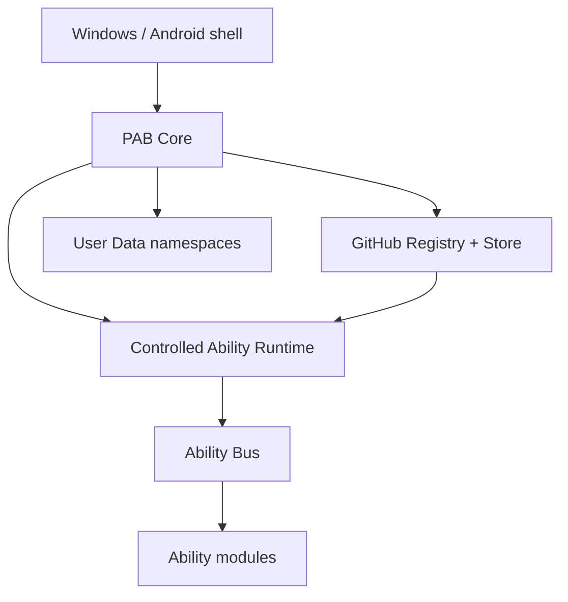
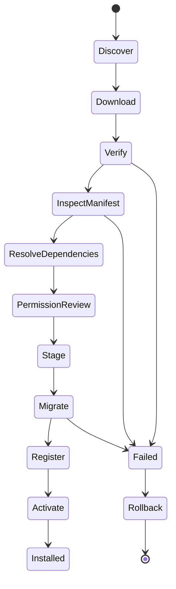

# PAB architecture overview

## Product boundary

PAB is a capability operating system, not a note editor with a marketplace
skin. The three hard boundaries are:

1. **Core** — shell, storage contracts, runtime, registry, permissions,
   lifecycle, buses, backup, diagnostics.
2. **Ability** — versioned code and UI contributions loaded through the
   controlled SDK context.
3. **User data** — namespaced records that remain when Ability code is
   disabled, rolled back, or uninstalled.

## Runtime contract

The v0.2 runtime accepts JavaScript modules with a `manifest.json` and an
`activate(context)` export. The context exposes only registration, event,
command, search, notification, memory, settings, and namespaced storage
operations. Ability-to-Ability request/response calls are registered in the
Core-owned Request Bus and receive correlation events; there is no implicit
cross-module database access. A native shell supplies the module loader; the Core never runs
downloaded Kotlin/Java or arbitrary Node/Electron code.

The checked-in `@pab/platform-adapters` package now defines the Windows and
Android capability bridge boundary. The next hardening step is to put
downloaded entries in a Web Worker/WebView realm with resource limits. WASM
is reserved for explicitly declared compute abilities.

The SDK is a host capability, not a permission to load arbitrary NPM code: the
Windows/Android loader maps the `@pab/ability-sdk` specifier to the Core-bundled
SDK shim (or prebundles that tiny shim when preparing a release). A downloaded
Ability therefore cannot fetch additional packages at activation time.

## Install state machine

The UI maps stable error codes (`HASH_MISMATCH`, `SIGNATURE_INVALID`,
`DEPENDENCY_CONFLICT`, `CORE_VERSION_UNSUPPORTED`, `MIGRATION_FAILED`, etc.)
to actionable messages. It must never show only “Unknown Error”.

`packages/registry-security` exposes `GitHubAbilityStore` for the complete
host flow: refresh the raw GitHub Registry, use the last valid cache offline,
resolve a single Ability or Pack, download release assets, verify them, and
hand versioned modules to the host loader. `PABCore.refreshRegistry()` also
hydrates the Core dependency catalog and emits `registry.refreshed` or
`registry.offline` events.

## Platform strategy

The shared layer is runtime-neutral ESM/TypeScript contracts. The first shells
are:

- Windows: a native shell can host the dashboard in a WebView and provide
  filesystem, hotkey, notifications, and updater adapters.
- Android: a WebView/Capacitor shell can host the same dashboard and provide
  Share Target, Quick Tile, widget, notification, and app-storage adapters.

The UI communicates through `window.PABCore` only. This avoids writing a
second Ability implementation for each platform. Native adapters can swap
JSON/SQLite/Room persistence behind the async storage contract.

## SiYuan boundary

SiYuan remains an optional future `pab-storage-siyuan` adapter. It is not a
Core dependency and an Ability cannot call SiYuan HTTP routes directly. The
adapter can expose a small, versioned subset of block/search/import operations
after compatibility tests pass.
